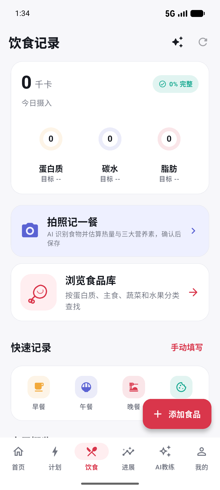
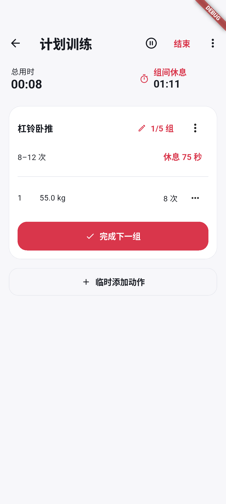
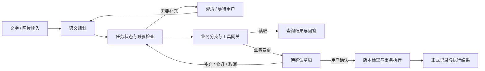
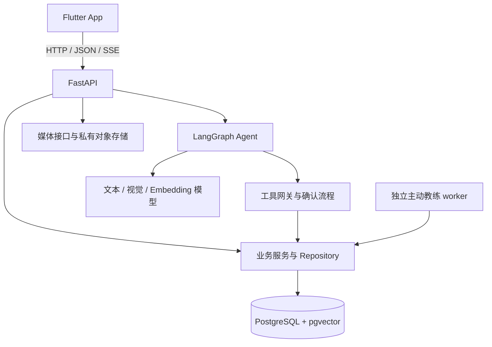

<div align="center">

# NxtRep

**记录每一次训练，让 AI 建议落到可确认、可追溯的行动上。**

面向个人训练、饮食与身体进展的 AI 辅助 App


[界面预览](#界面预览) · [Agent 设计](#agent-设计) · [工程实现](#工程实现) · [验证记录](#验证记录) · [运行项目](#运行项目)

</div>

NxtRep 将训练计划、记组、餐食、饮水和身体测量放在同一套业务系统中，AI 教练可以读取这些记录、理解连续对话、调用工具，并生成等待用户确认的修改草稿。

项目的重点是 **Agent 与真实业务的连接**：模型负责理解与建议，程序负责权限、参数校验、草稿状态、事务执行和失败恢复。当前已完成 Windows 本地后端与 Android 模拟器验收；SwiftUI 原生 iOS 0.3.0 已完成同后端功能迁移并通过真机编译，正在按清单做 iPhone 验收；生产部署仍在准备阶段。

## 界面预览

<table>
  <tr>
    <th align="center">饮食记录</th>
    <th align="center">训练中记组</th>
  </tr>
  <tr>
    <td align="center"></td>
    <td align="center"></td>
  </tr>
  <tr>
    <td align="center">餐次记录 · 照片估算 · 食品库</td>
    <td align="center">重量与次数 · 组间休息 · 训练控制</td>
  </tr>
</table>

以上为项目界面与本地验收截图；训练图来自 Android 模拟器 Debug 包。截图展示交互，不作为营养估算准确率或 iOS 兼容性证据。

## 核心功能

| 模块 | 已实现的流程 |
| --- | --- |
| **训练管理** | 按目标、器械和训练频率选择计划；日历安排、训练中记组、组间休息、暂停继续、自主训练与历史回顾。 |
| **饮食与饮水** | 食品库、餐次与饮水记录、每日营养汇总；餐食照片经 AI 估算后，用户核对或修改再保存。 |
| **身体进展** | 体重、围度和趋势；围度体脂估算展示方法与范围，并与用户手填数据区分。 |
| **AI 教练** | SSE 流式对话、图片输入、业务查询、知识检索、长期记忆；支持补充参数、插问后继续、修订和取消草稿。 |
| **确认与恢复** | 重要业务变更先展示确认卡；会话和待处理草稿可恢复，确认后执行，旧版本草稿不能覆盖新状态。 |
| **离线记录** | 饮食、饮水、身体测量及已开始训练的记组可先保存在本机再同步；部分表单和照片草稿支持恢复。 |
| **账户与提醒** | 修改密码、查看和撤销登录设备；可选的训练、三餐、饮水、身体记录本机定时通知。 |
| **主动复盘** | 独立 worker 在用户开启后检查记录缺口并生成建议；记录缺失保持为未知，不直接推断用户未训练或未进食。 |

## Agent 设计

以一段记录对话为例：用户先提出训练或餐食记录，随后补充重量、次数或份量，中间插入一个问题，再回到原草稿。系统需要保留正在处理的任务，区分查询与修改，并在用户确认后才写入正式记录。



| 工程问题 | 实现方式 | 源码入口 |
| --- | --- | --- |
| 连续多轮、缺参和话题切换 | 语义规划与持久任务状态分开；在任务中合并补充信息，并保留恢复所需上下文。 | [规划](backend/src/nxtrep_backend/services/agent_planning.py) / [任务状态](backend/src/nxtrep_backend/services/agent_task_state.py) |
| 模型输出不合法或超时 | Schema 校验、有界格式修复、超时边界和明确失败状态；不把无效参数直接交给业务执行。 | [意图路由](backend/src/nxtrep_backend/agents/intent_router.py) / [错误处理](backend/src/nxtrep_backend/services/agent_errors.py) |
| 工具调用可能产生副作用 | 工具网关执行权限与参数检查，记录调用结果；模型提出的修改进入业务确认流程。 | [工具网关](backend/src/nxtrep_backend/agents/tools/registry.py) / [调用日志](backend/src/nxtrep_backend/agents/tools/journal.py) |
| 草稿过期、旧卡与重复操作 | 数据库存储确认状态，结合版本检查和事务执行；修订后旧草稿失效，失败可追踪。 | [确认服务](backend/src/nxtrep_backend/services/confirmation.py) / [草稿修订](backend/src/nxtrep_backend/agents/tools/draft_revision.py) |
| 记录、目标和知识容易混淆 | 业务记录通过授权工具读取；知识经 PostgreSQL 全文检索与 pgvector 检索，保留来源边界。 | [业务工具](backend/src/nxtrep_backend/agents/tools/) / [知识检索](backend/src/nxtrep_backend/knowledge/) |

重要变更经过用户确认；长期记忆使用单独的管理规则。本机提醒、后台 worker 和远程推送具有不同的运行边界，当前本机提醒不依赖 Dart 常驻计时器，也不等同于远程推送。

## 工程实现



| 层次 | 技术与职责 |
| --- | --- |
| 客户端 | Flutter / Dart，按功能组织页面、控制器和数据层；消费 SSE，管理安全存储、离线队列与本机通知。 |
| HTTP 与业务 | FastAPI、Pydantic、SQLAlchemy Async；Router → Schema → Service → Repository。 |
| Agent | LangGraph、LangChain；语义规划、业务分支、工具调用、回答合成与执行日志。 |
| 数据与检索 | PostgreSQL、pgvector、全文检索；Alembic 管理数据库迁移。 |
| 外部能力 | 可配置的文本、视觉与 Embedding 模型；私有对象存储承载用户照片。 |
| 验证 | pytest、Ruff、Flutter 单元 / Widget 测试、Android 模拟器集成测试及按需启用的真实模型验收。 |

数据按用户隔离；可重试创建通过幂等键处理，编辑使用版本检查。访问令牌仅驻留客户端内存，刷新令牌存入系统安全存储，后端支持轮换与撤销。餐食营养和围度体脂均作为估算展示，允许用户复核。

## 验证记录

以下为 **2026-11-03 的本地验收快照**，不是 GitHub Actions 的在线状态。不同范围存在重叠，测试数不累加，跳过项不计为通过。

| 范围 | 结果 | 记录 |
| --- | --- | --- |
| 后端全量，显式开启 PostgreSQL 集成测试 | **2146 passed / 65 skipped**；1 条旧 pytest 缓存权限警告 | [清理后的回归](docs/PROJECT_CLEANUP.md) |
| Flutter 单元 / Widget | **271 passed**；同日静态复验无问题 | [基础验收](docs/CLOSEOUT_ACCEPTANCE.md) |
| 原失败 AI 场景的真实接口复验 | **2 项通过**：长多轮与营养追问 | [修复与复验](docs/AI_MULTITURN_RELIABILITY_FIX.md) |
| 完整 Android AI 对话 | **1 条流程通过**：查记录、修订、确认、取消、改期与训练递增 | [设备复验](docs/AI_MULTITURN_RELIABILITY_FIX.md) |
| Android 基础业务与恢复 | 训练控制、饮食导航、账户安全、离线写入与跨进程恢复已验证 | [收尾验收](docs/CLOSEOUT_ACCEPTANCE.md) |

验收文档保留范围、失败历史与复验结果。包含环境信息的原始日志保留在本地，不随源码发布。普通测试默认跳过需要显式开启的数据库、模型、媒体或设备场景。

<details>
<summary><strong>运行自动化检查</strong></summary>

后端基础检查，在 `backend` 目录执行：

```bash
uv run ruff check src tests
uv run pytest -q
```

显式开启本地 PostgreSQL 集成测试（PowerShell；先配置并迁移测试使用的本地数据库）：

```powershell
$env:RUN_DATABASE_TESTS = '1'
uv run pytest -q
```

数据库测试会创建并清理测试数据，请使用开发 / 测试数据库。真实模型和设备验收使用独立开关与测试账号，运行方式见对应验收文档。

前端检查，在 `frontend` 目录执行：

```bash
flutter analyze
flutter test
```

</details>

## 运行项目

环境要求：Flutter（本机验证版本 **3.47.4 / Dart 3.13.3**）、Python **3.12+**、PostgreSQL 与 pgvector。模型和对象存储按需配置；iOS 编译需要 macOS 与 Xcode。

**启动后端**

将 `backend/.env.example` 复制为 `backend/.env`，配置本地数据库连接与随机 JWT 密钥。然后在 `backend` 目录执行：

```bash
uv sync --extra dev
uv run alembic upgrade head
uv run uvicorn nxtrep_backend.main:app --app-dir src --host 0.0.0.0 --port 8000
```

数据库需启用 `vector` 扩展。就绪检查为 `http://127.0.0.1:8000/api/v1/health/ready`，交互式 API 文档为 `http://127.0.0.1:8000/docs`。模型、Embedding 和对象存储凭据仅配置在后端；缺少配置时相关能力明确失败。

**启动前端**

启动 Android 模拟器，然后在 `frontend` 目录执行：

```bash
flutter pub get
flutter devices
flutter run -d emulator-5554
```

将设备 ID 替换为实际设备。Android 模拟器默认连接 `http://10.0.2.2:8000/api/v1`；真机或发布构建通过参数指定可访问的 API：

```bash
flutter run --dart-define=API_BASE_URL=https://api.example.com/api/v1
```

已配置的 Windows 开发机也可使用根目录 `Start-NxtRep.cmd` / `Stop-NxtRep.cmd` 按需启停；它们复用本机数据库、测试账号和正常 APK 缓存，不替代首次环境配置。详见 [Windows 启停说明](scripts/README.md)、[后端说明](backend/README.md)和[前端说明](frontend/README.md)。

## 项目结构与阅读入口

```text
NxtRep/
├── frontend/                  Flutter App、单元测试与设备测试
│   └── lib/features/          训练 / 饮食 / 进展 / AI / 账户
├── backend/
│   ├── src/nxtrep_backend/    API、Agent、业务服务、仓储与 worker
│   ├── migrations/           Alembic 数据库迁移
│   └── tests/                单元、接口、数据库与真实服务测试
├── docs/                     架构、接口契约、验收与问题复盘
├── scripts/                  本机启停与质量检查
└── deploy/                   尚未执行的生产部署准备
```

建议从 [架构与取舍](docs/ARCHITECTURE.md) 开始，再阅读 [Agent 装配入口](backend/src/nxtrep_backend/agents/factory.py)、[Agent 接口设计](docs/AGENT_INTERFACE_SPEC.md)、[移动端契约](docs/MOBILE_API_CONTRACT.md)和 [RAG 来源说明](docs/RAG_KNOWLEDGE_SOURCES.md)。

## 当前边界与下一步

- SwiftUI 0.3.1 已通过 macOS 编译和 17 组客户端检查。0.3.0 在 iPhone 验证了登录恢复和饮水保存，动作库修复及其余业务按对齐清单复验。[功能对齐清单](docs/native-ios/PARITY.md)
- **部署**：正式后端尚未上线；后续需要 HTTPS、密钥管理、备份恢复演练和运行监控，见 [部署准备](deploy/README.md)。
- **照片质量**：识别结果属于估算，尚未完成已知份量、参考营养的真实餐图准确率验收。
- **设备覆盖**：Android 模拟器结果不代表实体手机、锁屏、省电策略或完整日 / 周通知周期均已通过。
- **产品范围**：当前是个人项目与开发验证版本，尚无生产用户规模或线上 SLA 数据。健身与营养建议不作为医疗诊断。
