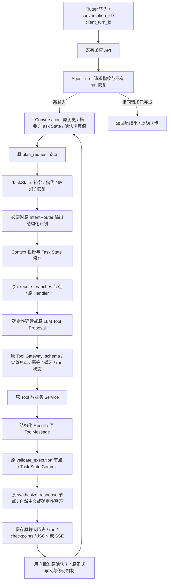

# 多轮 Agent 增量补强与验收

日期：2026-10-08。依据用户第二版六层执行链与 12 个多轮案例实施。本文描述这次增量结果；[修改前审计](AGENT_MULTITURN_PRODUCTION_AUDIT.md)和[第一批 P0 验收](AGENT_MULTITURN_P0_ACCEPTANCE.md)保留作历史证据。

现有四个 graph 节点、业务 API、正式业务数据、确认批准接口及 Flutter 页面继续使用。没有更换 Agent 框架。新增内容是任务状态、上下文投影、既有 Tool Gateway 的校验与执行日志、稳定的消息重放，以及少量原业务 Service 的提案能力。正式修改仍先出草稿、校验、用户批准再执行。

## 当前调用链

读工具仍可检索候选；写工具必须核对真实对象。会话结构化状态不会替代数据库业务真值。训练和餐食确认卡在下一轮按当前数据库状态恢复，不能因旧聊天写着“待确认”而再次新建记录。

任务状态、聊天历史、摘要、长期记忆、run、确认与请求幂等继续由 PostgreSQL 持久保存。本轮没有加入 Redis 会话状态、Redis checkpoint 或新的后台 Agent 服务；原 worker 仍负责主动提醒，普通多轮聊天不需要启动它。本地 PostgreSQL 当前为 Manual 启动类型，API、模拟器均按需运行。

## 六层落点

| 层 | 本次补充 | 主要模块 |
| --- | --- | --- |
| 输入理解 | 沿用 IntentRouter；常见单位、数字补参和唯一指代先由代码处理；真实歧义才澄清 | `agents/intent_router.py`、`services/agent_planning.py`、`agent_task_state.py` |
| 状态管理 | 会话 JSONB 保存 task_id/type/status/entities/parameters/missing_fields/current_step/最近结果；一个当前任务和一个暂停任务；跨领域不继承数值 | `schemas/agent_task.py`、`services/agent_task_state.py`、`conversation.py`、迁移 `da6e91c7b240` |
| Context | 完整历史继续保留；优先状态和实体，选择最近与相关消息；限制摘要、RAG、记忆与结果长度；裁剪完整 ToolCall/ToolMessage 块 | `services/agent_context_builder.py`、planner、General、synthesis |
| Planning | 在原任务计划上增加 task_update；已确定的补参、取消、恢复及结果状态不再额外询问 LLM | `schemas/agent.py`、`agent_planning.py`、`agent_handlers/task_action.py`、`agents/nodes.py` |
| Tool Runtime | 复用注册工具；schema、业务所有权与版本、Task State 对象冲突、run 写入权限、既有确认、重复操作和未知结果保护 | `agents/tools/registry.py`、`services/agent_turn.py`、`agent_run.py`、原业务 Service |
| Reliability | 请求重放、断线核实、失败草稿强关联恢复、有限调用/循环限制、异常分类、脱敏工具快照与状态变化、多轮测试 | `agent_turn.py`、`agent_task_recovery.py`、`agent_errors.py`、`agent_tool_review.py`、controller 与新增测试 |

新增训练记录提案复用 `WorkoutService` 的训练、动作和组操作，新增创建/整体更正/整体作废三个确认类型。作废保留修订历史，并保留同训练中的其他动作。新建训练保持进行中以便追加动作，不会把已经完成的历史训练悄悄重新打开。餐内单项删除复用原饮食更正机制、原索引和营养重算，不以食品库 ID 代替餐内项目。

## 幂等、恢复和异常的实际边界

- `client_turn_id` 是可选 UUID，旧客户端接口仍兼容。新前端同一输入的网络重试保留完整原请求及标识；新输入使用新标识。同标识、不同内容返回冲突。
- 终态重放返回原 run 和原卡片，不新增聊天消息，不重新执行 graph。正在执行的相同输入返回原 run_id。缓存过期或缺失时继续核实原 run，不把缓存缺失当成重新执行的许可。
- Tool Gateway 对同 run、同工具、同规范化参数的副作用调用复用已有结果；未知写结果不自动重复执行。正式批准继续使用已有幂等批准接口、版本校验及事务。
- 断线后有 run_id 就先查询结果，没有 run_id 时用户点击“核实上次结果”，重放原请求标识。失败或取消的原 run 不重新执行。跨进程陈旧 run 先封闭并限制迟到写入，不自动重启原 Action。
- 失败后恢复草稿要求所有权、conversation、精确 task_id、工具调用 ID、返回的确认引用与当前卡片真值一致；不能只凭“最近一张类似卡片”恢复。多个可靠结果要求选择。
- 鉴权错误、业务版本冲突和业务条件不满足不换模型重试。模型、联网和数据访问异常保留各自公开错误；提示词要求自然说明真实失败原因，不声称成功或已查网页。
- 本地知识无结果或不足的公开健身问题，经语义抽取和隐私检查后的通用关键词进入原联网工具预检，不靠模型自行记住“必须搜索”。只在实际调用后保存搜索结果；无安全关键词不复制原消息。普通热量估算在搜索不可用时可明确说明无来源并先给估算，用户明确要求联网核验时仍保留真实失败。
- 总 workflow 超时仍为既有 120 秒默认值；意图路由预算从 12 秒调为 30 秒、默认自动重试仍为 0。依据是两次重启后的首轮真实接口在约 13 秒超时；独立同模型探测约 1.3 秒，因此不把预算调整等同于证明或消除外部服务延迟根因。
- 工具数量、步骤和重复调用限制沿用已补强 Gateway。动态上下文使用字符预算，不宣称是精确 tokenizer 计数；完整参数不在裁剪后用于业务执行。
- 每个 run 关联 conversation_id、turn_id、task_id、trace_id 与 Gateway tool_call_id。checkpoint 保存有限、脱敏的参数/结果快照、指纹、状态变化及耗时；原用户输入保留在受鉴权保护的历史中。自由文本和凭证字段不会原样进入工具快照。

## 十二个案例的验收落点

| 案例 | 预期与本轮覆盖 |
| --- | --- |
| 1 参数逐轮补全 | 卧推 → 60kg → 四组8次，同一 task 累积；参数齐全才生成确认卡，批准前无正式组记录 |
| 2 已记录纠正 | 55kg 修改原 workout/exercise 的组，训练条数不增加；版本冲突阻止执行 |
| 3 餐内指代 | 使用已保存 entry_id + 当前餐内 item_index；只更正鸡胸肉、其他食物原样保留 |
| 4 模糊删除 | 有整餐/多个食物时列出候选，不任意选最近一项；唯一可靠目标才继续 |
| 5 切换恢复 | 饮食只读问题不污染训练参数，返回训练时复用原任务和原确认卡 |
| 6 局部追加 | 新动作继承日期/会话，重量、组数、次数重新收集；没有沿用前一动作数值 |
| 7 执行前取消 | task cancelled，不再追问，不生成业务记录；已有 pending 卡则真实取消卡片 |
| 8 保存后撤销 | 生成对应作废/删除确认卡；批准后修改真实数据，不能只清空 Agent 状态 |
| 9 超时幂等 | PostgreSQL 故障注入验证已提交草稿、结果丢失/缓存缺失/同 key 重放，原 run/card 保留，graph 不执行第二次；正式批准重复仍只执行一次 |
| 10 Tool 循环 | 相同搜索/参数重复且无进展被限制；回传错误或要求改变策略，不无限调用 |
| 11 长对话 | 30 轮以上仍读取真实实体和最近修改；Storage History 与模型 Context 分开，完整历史不被删掉 |
| 12 确定性 Commit | 按结构化 result/确认真值直接更新状态；pending 草稿不等同于业务已成功 |

这些案例由状态单测、真实 graph 的脚本路由测试和 PostgreSQL 集成测试共同覆盖；真实模型/API及设备覆盖范围在下方单列，不能将脚本测试等同于模型或完整设备验收。

## 本轮验证记录

| 检查 | 最终结果 | 验证范围与证据 |
| --- | --- | --- |
| 后端完整自动化 | **1585 passed / 28 skipped，27.10秒** | 启用 `RUN_DATABASE_TESTS=1`，含真实 PostgreSQL 多轮、事务/故障注入、幂等、长会话、确认与权限测试；[日志](../.local/multiturn-backend-final-tests.log) |
| 代码检查 | **Ruff 通过** | 全部 backend/src 及本轮主要新增/增强测试；已有未属于本轮的测试导入风格问题未纳入“全测试目录风格通过”的声明 |
| Flutter 全量测试 | **159 passed** | 历史分页、同请求标识、断线恢复、卡片展示等；[日志](../.local/multiturn-frontend-final-tests.log) |
| Flutter 静态检查 | **No issues found** | 全 frontend，含新增 device smoke；[日志](../.local/multiturn-frontend-final-analyze.log) |
| 真实模型 / 本地 API | **1条连续场景通过，25.54秒** | 临时验收账号，12轮用户输入、5次卡片批准、相同标识 HTTP/SSE 重放。验证训练补参→饮食插问→恢复→55kg更正→新动作缺参→取消；餐食创建→指定食物修改→歧义澄清→只删鸡胸肉。检查实际数据库条数/组/份量。账号与测试动作在 fixture 清理。[证据](../.local/agent-multiturn-live-20261008.json)、[日志](../.local/agent-multiturn-live-20261008.log) |
| Android 模拟器 | **1条脚本多轮流程通过** | Pixel_8 / emulator-5554，真实页面/controller/repository，MockClient 脚本后端；输入补全→丢响应→核实原请求→创建卡批准→55kg更正→作废卡批准。只验证前端行为和协议，未连接真实模型。[日志](../.local/multiturn-device-scripted-smoke.log) |
| 正常 App 构建与安装 | **成功** | 脚本测试后重新构建 `lib/main.dart` 正常入口、安装并启动，当前显示登录页；没有留下测试入口 APK，也未替用户登录。[日志](../.local/multiturn-normal-app-build.log) |
| 云 / 真实 iOS / 完整真实服务设备多轮 | **未验证** | 按当前范围保留；真实 API 与脚本设备测试不能合称完整设备真实模型验收 |

真实模型验收不是统计性质量保证。此前验收先后暴露了首轮路由预算、未执行联网、食品短称、并列食物参数及刷新清除澄清状态的问题，均定位实际返回后最小修复，再将失败场景纳入回归；历史失败证据保留在 `.local/agent-multiturn-live-*-*.json`。最终通过仅说明当前这一条连续场景已经实测成功。

28项跳过包含默认未启用的真实模型/媒体及其他需额外配置的测试；没有将跳过项计算为通过。工具超时、重复调用、RAG无结果和长会话以自动化/数据库故障注入验证，没有在真实服务上强制制造这些故障。

## 在 App 里的验收步骤

先用项目原按需启动入口运行最新后端与 Android App。当前本地数据库已应用新增 task_state 迁移。测试使用专用记录，确认卡批准会写正式数据。

1. 新建 AI 会话，输入“帮我记录今天杠铃卧推”，接着分别输入“60kg”“四组，每组8个”。前两轮只补参数，第三轮显示 60kg/4组/8次草稿。没有点击确认前，训练正式记录不应增加。如果动作目录有多个同名候选，应先选明确动作。
2. 草稿出现后插问“一份鸡腿饭大概多少热量”，再说“继续刚才的训练”。原草稿应能继续确认，不能新建一份相同草稿。热量估算有份量与不确定性，真实搜索链接由既有小行来源展示；无来源时不得显示假链接。
3. 点击“确认记录”。输入“不对，重量是55kg”，应出现原动作的更正预览。确认后查看训练详情，仍是原训练，四组改为55kg。
4. 输入“再加一个上斜杠铃卧推”。应重新询问新动作重量/组数/次数，不继承55kg/4×8。输入“算了，不记了”，应结束补参，原卧推保持不变。
5. 新会话输入“午饭记录米饭200g、鸡胸肉150g”，确认；再说“刚才那个鸡胸肉改成200g”，确认后只该项份量变化，午饭只一顿。
6. 输入“把刚才那个删了”，若存在整餐与两项食物，应具体澄清。说明“只删除午饭中的鸡胸肉，保留米饭和整顿午饭”，核对删除预览再确认；剩下米饭200g，营养总计重算。
7. 对已确认卧推说“刚才记录的卧推不要了”。核对作废卡并确认，原动作的组作废，同训练其他动作保持。取消未确认卡与撤销已保存记录的预览应不同。
8. 本地调试可在发送后短暂断开网络，再恢复。页面显示“核实上次结果”时点击它，应查询/重放原 run，不能出现第二条相同记录。尚在运行时继续等待核实，不把错误当成功。
9. 继续聊天后再指定“刚才卧推改回60kg”。如果原动作仍有效且唯一，读取原 ID 后更正；目标已作废或存在多个候选时说明状态/要求选择，不猜另一条记录。

## 保留的限制

- 这是增量完成的本地版本，不代表已经完成云端运维或真实 iOS 验收。
- 轻量状态只有一个 active 和一个 suspended task，没有多任务栈。当前重点保证训练记账、餐食更正和既有草稿恢复；复杂跨多条记录的操作仍需要明确目标和既有工具支持。
- 普通自然语言仍有 LLM 的判断波动，网络与模型服务仍可能超时；结构化状态、权限、确认和幂等负责阻止错误写入，并保留可核实结果。
- 不同 client_turn_id 的新消息不按文字相同强行合并，因为用户可能确实再次吃一餐或再次训练。保证的是同请求重试和同 run 重复工具不会误产生重复写入。
- 前端断线原请求保留于当前 controller 生命周期；App 重启后恢复服务器历史和确认卡，不自动重发旧输入。尚未建立持久离线发送队列。
- 食品短称只做唯一可靠匹配；生/熟、不同部位或多个近似食物不能唯一确定时会澄清。营养估算仍有份量和烹调差异，不把通用估算伪装成网页精确核验。
- 正式撤销沿用各业务能力。训练整动作作废会保留原训练会话及修订，不物理删除整次训练；餐内删光最后一项时要求选择整餐删除。
