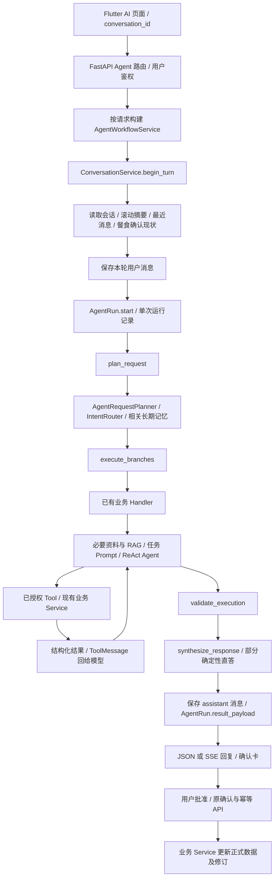

# 多轮 Agent 生产稳定性增量审计

审计日期：2026-10-08。对象是当前 NxtRep Flutter / FastAPI 项目的既有 Agent，不是新建 Agent。

本文件记录修改前的只读审计基线和增量方案。用户随后授权按第二版六层标准与12个案例依次补齐剩余框架；当前增量实现和验证以[生产多轮验收记录](AGENT_MULTITURN_PRODUCTION_ACCEPTANCE.md)为准。第一批 P0 的历史结果见[第一批验收](AGENT_MULTITURN_P0_ACCEPTANCE.md)。下文“当前实现”和问题清单描述审计时的基线，不能把已补强部分再次当作未修改代码。不进行云部署、真实 iOS 验收、提交或推送，不设本地服务自启动。

## 证据与结论边界

- **当前代码事实**：阅读 API、factory、graph / nodes / runtime、路由、上下文、各 Handler、工具注册和包装、conversation / run / memory、确认机制、相关 schema / repository 及测试后得到的实现事实。
- **已观测问题**：此前真实餐食补充导致新增两条午餐，原因和先前修复证据见 [重复午餐修复](AGENT_MEAL_FOLLOWUP_DUPLICATE_FIX.md)。此前营养反馈误入长期记忆、流式等待问题另见 [多轮验收记录](AGENT_MULTITURN_ACCEPTANCE.md) 和 [等待超时修复](AGENT_STREAM_TIMEOUT_FIX.md)。本轮另外只读核实了真实失败 run，见下节；历史故障记录不表示本轮重新执行过旧验收。
- **由代码推导的风险**：本轮指出的并发、失败恢复、历史校验污染、短句指代和任务恢复缺口。没有相应当前运行日志时，不把风险说成这次用户失败的已证明根因，也不声称数据库已经发生了这些错误。
- **读取测试不等于执行测试**：本次审计阶段只检查测试实现和已有验收记录，没有运行自动化、真实模型或模拟器。新增修改后的执行结果应单独记录；跳过项不算通过，接口验证不等于设备或真实 iOS 验证。

## 本轮真实失败核实：读取成功但没有生成提案

实施方按需手动启动本地数据库，进行了只读查询。已核实的失败 run 前缀为 `478b07c2`：

| 项目 | 实际记录 |
| --- | --- |
| 当前用户输入 | `脂肪应该多一点` |
| 路由任务 | `nutrition_entry_update_draft` |
| tool_runs | 只有 `read_saved_meal_for_change`，状态 `available`，耗时 2ms |
| 提案工具 | 没有 `propose_saved_meal_update` 的执行记录 |
| 最终错误 | `SAVED_MEAL_DRAFT_NOT_CREATED` |

这一条可以确认“保存餐食读取成功，但没有生成更正提案”。它不是读取超时，也不能据此把所有多轮故障归为聊天历史丢失。当前 [更正工具 schema](../backend/src/nxtrep_backend/schemas/nutrition.py) 和 [更正 Service](../backend/src/nxtrep_backend/services/nutrition.py) 只支持所选食物克数变更，沿用保存时的营养基准；不允许 Agent 直接覆盖这餐的脂肪营养快照。

“脂肪应该多一点”可能是在质疑原营养估算，也可能要改实际食物份量；没有足够信息确定具体食物和新克数。因而能力边界、修改意图与参数补全/澄清都需要处理，不能直接填一个脂肪数字或猜改米饭克数。现有 trace没有此次模型的完整 arguments、上下文及决策过程，**不能断言模型真实想法或唯一根因**。

增量目标是给出自然、可理解的澄清或范围说明，例如核对“是想更正实际食物份量，还是觉得原脂肪估算偏低”，而不是只返回泛化的执行失败。此故障应纳入 P1真实回归：读成功、无法合法提案时，保留原记录并明确缺口；不能伪装保存成功或用记忆/每日目标操作代替。

## 当前真实调用链

入口与组装见 [Agent 路由](../backend/src/nxtrep_backend/api/routes/agent.py)、[factory](../backend/src/nxtrep_backend/agents/factory.py)、[Workflow](../backend/src/nxtrep_backend/services/agent_workflow.py)。四节点及边关系见 [graph](../backend/src/nxtrep_backend/agents/graph.py) 和 [nodes](../backend/src/nxtrep_backend/agents/nodes.py)。`services/agent.py` 是旧兼容入口，不能用它的单条消息实现代表当前 App 的完整主链路。

`AgentBranchExecutor` 支持同轮多意图；饮食记录分支可读取本轮先前分析结果。factory 配置请求内的执行锁，避免分支和工具同时使用共享 AsyncSession。这不等同于跨请求的会话串行保护。

## 六层职责与现状

| 层 | 现有模块与职责 | 已有能力 | 需要增量补强 |
| --- | --- | --- | --- |
| 1. 输入理解层 | `AgentIntentRouter`、`AgentRequestPlanner`、task Prompt | 结构化多标签意图、确定性 shortcut、语义复核记忆、confidence 与澄清字段、局部餐食省略处理 | 缺统一的真实实体焦点、稳定候选选择、继续/纠正/取消/切换/恢复识别；省略表达仍需窗口推断 |
| 2. 状态管理层 | `AgentGraphState`、`AgentIntentTask`、conversation / run | 有当轮 task_type、missing_fields、graph state、run 状态与最后节点；餐食确认现状可恢复 | 缺持久 active task、参数累积、候选、current_step、暂停恢复。沿原 conversation 加轻量状态，不用长期记忆或 run checkpoint代替 |
| 3. Context 层 | `ConversationService`、`agent_context.py`、个人资料和知识 Handler | 完整存储历史；12条消息窗口；超过20条增量摘要；近期24,000字符、摘要6,000字符上限；相关长期记忆；本地知识不足时补联网 | 保护任务实体和参数；统一总预算与相关性选择；给摘要独立时限；短检索问题继承可靠主题；不删除历史 |
| 4. Planning 层 | planner / router、业务 Handler、现有 ReAct Agent、nodes / synthesizer | 结构化意图计划、分支选择、原LLM工具规划与ToolMessage闭环、确定性安全检查及部分直答 | 缺Task State到候选Action的一致性检查；完成状态不能再交模型猜；旧review必须按是否已解决判定；无法合法提案时自然澄清 |
| 5. Tool Runtime 层 | tools registry / runtime、Pydantic schema、原业务 Service与确认API | 任务白名单；类型/范围校验；真实ID、归属、状态、版本、read-before-write；结构化结果；重要操作先草稿；同确认批准幂等 | 在现有包装点补共享journal、完整参数去重与结果校验；聊天turn/action幂等；选定目标与Task State一致性。原Tools/Services继续保留 |
| 6. Reliability 层 | `AgentWorkflowService`、`AgentRunService`、`agent_errors.py`、monitor与Eval | 整体时限、有限重试、32步限制、SSE心跳/断流/取消、分类错误、未提交写超时回滚、基础Trace与部分多轮测试 | 总tool预算与重复无进展保护；跨请求并发；失败草稿恢复；任务取消与业务撤销分离；恢复后再重试；受控Trace与12类多轮Eval |

Tracing 横跨六层，已有 `conversation_id` / `run_id`、节点耗时和工具名称/状态/耗时；缺少统一的 task_id、tool_call_id、受控参数与结果摘要、状态变更轨迹及上下文选择摘要。应扩展现有 monitor / tool_runs，不建设独立监控平台。

### 标准执行链逐项映射（修改前基线）

| 标准环节 | 当前真实位置与状态 | 最小增量入口 |
| --- | --- | --- |
| User Input | Agent API + ConversationService，已保存user消息 | 保留；在保存前做会话运行占用检查 |
| Intent Detection | planner/router，已实现 | 加可靠Task State承接与候选意图校验 |
| Entity / Reference Resolution | Prompt、近期消息、餐食卡与read tools，部分实现 | Task State小resolver；真实多候选再澄清 |
| Task Switch Detection | Prompt仅识别话题，缺持久暂停/恢复 | 原planner前加轻量判断；需要时一个suspended快照 |
| Task State Update | 仅当轮AgentIntentTask/GraphState，跨轮缺失 | 原conversation新增兼容JSONB字段与小辅助service |
| Missing Fields Check | 单轮missing_fields及Service/schema校验，部分实现 | 已知slot合并后由代码检查，清除已补字段 |
| Context Builder | window/summary/memory/profile/RAG已存在 | 扩展现有agent_context，不建重复memory系统 |
| LLM Planner | 原create_agent +任务Prompt，已实现 | 保留；候选Action受状态与工具白名单约束 |
| Action / Tool Proposal | 结构化Tool Call已实现 | 附任务/行动身份，不改原Service接口 |
| Tool Preflight Validation | schema、权限、版本、read-first已实现 | 加选定实体、允许字段与Task State一致性 |
| Idempotency Check | 同确认批准及部分builder缓存，覆盖不完整 | 原wrapper共享journal；后续聊天稳定turn重放 |
| Tool Execution | 原Tool调用原Service，已实现 | 保留；无副作用成功结果不得重试写入 |
| Result Validation | Handler提卡和safety后置校验，部分实现 | 原wrapper最小结构化结果校验、保留真实refs |
| State Commit / Rollback | DB事务、版本、确认执行、未提交timeout回滚已存在 | 独立管理Task State；结果refs与草稿同事务；已存数据撤销走原业务 |
| Response Generation | 原synthesizer、部分确定性直答、SSE核对，已实现 | 保留；准确表达草稿/生效/失败/未知，不伪成功 |
| Trace / Metrics | run/conversation、node和tool状态/耗时，部分实现 | 原run存gateway调用ID、参数指纹、结果refs；后续补task/turn及状态变化 |

## messages、状态、数据库和 Session 的真实职责

### 存储历史与模型上下文已经分离

[AgentConversation / AgentMessage](../backend/src/nxtrep_backend/db/models/conversation.py) 保存会话归属、状态、标题、版本、摘要、摘要截止序号、下一消息序号和 user / assistant 消息。历史没有被删除；[ConversationService](../backend/src/nxtrep_backend/services/conversation.py) 只向模型选择近期窗口，并进行摘要。

当前裁剪以字符数为依据，从最新消息向前保留，长消息仅取尾部；不是 tokenizer 预算，也不是按当前任务筛选。因此旧任务的关键参数可能不在窗口中，尾部裁剪还可能丢掉消息前半部的候选定义。无需另造一个 window-memory 系统，应在这个实现上增加任务优先级和总预算。

### 当前有三类状态，但都不等于持久任务状态

1. `AgentGraphState`：单次图调用的 user / request / planned_request / execution_bundle / response。当前 `graph.compile()` 没有持久 checkpointer。
2. `AgentRun`：单次执行的 request_payload、最后节点 checkpoint、result_payload、失败/取消状态和版本。checkpoint 是运行进度记录，不是可恢复的业务参数快照；结束时会改写成 completed 或 failed。
3. 正式业务与确认卡状态：具体 meal / workout set / plan / calendar / memory 等记录、修订和 Confirmation，由现有数据库与 Services 保证生效。

新一轮会话恢复的是 summary / recent_messages / meal_confirmations；它没有统一恢复上一轮的参数、missing_fields、候选列表、实体焦点或最新 ToolMessage。[AgentIntentTask](../backend/src/nxtrep_backend/schemas/agent.py) 的 missing_fields 是当轮计划字段，不能自动把用户下一条“8个”补入既定 reps slot。

### conversation_id 与权限

未传 conversation_id 时创建新会话；传入时只读取鉴权用户拥有且可用的会话。前端历史恢复和确认卡恢复继续使用该 ID。user_id 由鉴权和工具上下文提供，不接受模型冒充他人身份。会话版本和行锁已存在，应复用。

### PostgreSQL、Redis、worker

PostgreSQL 承担用户/业务记录、完整会话、摘要、长期记忆、确认卡、run 和已有 HTTP 幂等结果等持久职责。当前检查的 Agent 源码没有 Redis 客户端或 Redis task-state / checkpoint 使用；不能因为有 LangGraph 或 worker 就推断存在 Redis。公共搜索缓存是进程内有界缓存。worker 用于既有主动提醒，不是每次聊天的后台 Agent，也不承担此次参数补全。

## Prompt、RAG 和 Tool Result 如何进入上下文

- [runtime](../backend/src/nxtrep_backend/agents/runtime.py) 使用原 SYSTEM_PROMPT 与 TASK_PROMPTS，调用既有 `create_agent`；依据任务类型进一步过滤 proposal 工具。
- [文本 Handler](../backend/src/nxtrep_backend/services/agent_handlers/general.py) 组合最近聊天、滚动摘要、真实餐食确认状态、当前日期/时区/任务 scope、已读取的个人资料、任务相关长期记忆及必要知识证据。
- [知识 Handler](../backend/src/nxtrep_backend/services/agent_handlers/knowledge.py) 检索本地知识、过滤可疑证据、判断覆盖，缺失/不充足时交现有联网工具补充。它已区别无资料、检索失败、覆盖评估失败。必要证据以结构化 knowledge_context / 分支结果进入 ReAct 或回复合成。
- 原工具返回 `status`、真实 IDs、data / confirmation / candidates 等 dict，框架把结果形成 ToolMessage 回给同一次模型调用。下一轮的消息表没有保存原 ToolMessage；部分读结果和操作结果留在 run.result_payload，但不作为统一下一轮任务状态恢复。
- [回复合成](../backend/src/nxtrep_backend/agents/synthesis.py) 收到当前用户消息、conversation_context 和 execution_bundle。已有 nodes 对某些已核实结果直接生成回复，应该继续扩展该确定性边界。

## 已有保护及其不完整处

- Pydantic 已做参数类型、字段和数值范围校验；业务 Service 已检查实体存在、用户归属、状态和版本，不必重写一套 Service 校验。
- 已保存饮食和训练组工具要求先读取真值并记录当前版本；部分提案在工具构建闭包内去重。但闭包随重新构建 Agent 消失，不等于跨轮、跨 retry 或跨网络重试的 durable action 幂等。
- 正式批准已有 Idempotency-Key、一次性确认状态和版本检查。Agent 生成提案与 API 批准是两条不同的执行边界，不能把批准的保护直接当成聊天请求已经幂等。
- 业务草稿通常最多尝试两次；文本 ReAct 调用目前使用 **recursion_limit = 32**。这是图递归上限，不是按工具名称/参数/状态变化识别重复循环，也不是独立 max_tool_calls。
- 错误已分类为 MODEL_BUSY、AGENT_TIMEOUT、AGENT_NETWORK_ERROR、MODEL_ACCESS_DENIED、BUSINESS_STATE_CONFLICT、RECORD_NOT_FOUND、DATA_ACCESS_FAILED、AGENT_RESULT_INVALID、AGENT_STEP_LIMIT 等。仍有大范围异常 fallback，错误恢复策略需要和副作用结果核对结合。
- 已有更新/删除或作废业务能力不等于取消“Agent 正在收集的参数任务”。取消 task state 与回滚正式数据必须分开。

## P0 / P1 / P2 优先级

以下表格中“推导”表示代码存在路径或保护缺口，必须通过回归用例或真实日志验证具体影响。

| 优先级 | 问题与证据性质 | 影响 | 最小修改入口 |
| --- | --- | --- | --- |
| P0 | 同一 conversation 的跨请求执行没有全程串行约束；已有 row lock 在启动 run 的 commit 后释放，请求内 asyncio.Lock不能覆盖另一请求。**代码推导** | 多个轮次交错、旧参数覆盖/消息序号冲突或重复提案风险 | 既有 Workflow / run / conversation repository；轻量会话级执行保护，跨进程保护优先使用现有 PostgreSQL，不引入 Redis |
| P0 | 某节点已经提交操作，后续回复/流式阶段失败时，run 最终结果可能没有保存确认卡/必要操作恢复索引。回滚 pending 不能撤销此前 commit。**代码推导** | 用户看见失败后重试，产生重复提案或无法恢复已经生成的卡 | 现有 run.checkpoint / result_payload 与 Workflow 节点保存；保存可恢复操作摘要，失败后查询已产生结果 |
| P0 | 重建 Agent 或重试时部分闭包提案去重丢失；聊天请求与批准 API 的幂等边界不同。**代码推导** | 重复写草稿/重复动作风险，后续用户确认可能放大影响 | 既有 tool wrapper / request-scoped context / run；首先跨 builder 共享动作结果，durable动作键按真实需求扩展 |
| P0 | 餐食补充曾被当新增餐；已有 meal_confirmations 修补，当前仍缺稳定任务实体绑定。**历史观测 + 当前剩余风险推导** | 多份相似卡时修改错误餐或新建重复餐 | 在原 conversation 加轻量 Task State，planner / handler / tool wrapper验证绑定；不改营养业务核心 |
| P1 | missing_fields、候选和已知参数只存在当轮，省略输入要重新分类。**代码事实** | “250克”“第二个”重复问或任务跑偏 | 小 task-state schema / helper、原 planner 和 ContextAssembler |
| P1 | 真实输入“脂肪应该多一点”读取成功后没有proposal，最终为SAVED_MEAL_DRAFT_NOT_CREATED。现有工具只改克数，不支持直接改宏量营养快照。**本轮已观测 + 能力边界事实** | 合理自然追问被显示为泛失败，用户不知道要补什么、当前支持什么 | 原intent / Handler澄清与能力边界处理，保留营养Service约束；读成功却缺合法修改参数时明确询问或说明范围 |
| P1 | general Handler 收集整次 ReAct 的 needs_review；早先已解决错误也可能优先于后来成功读取和合法 proposal。**代码推导** | 参数修正后仍显示 needs_input / 旧错误 | 原 Handler 结果判定；依据同实体的最新已解决状态，保留未解歧义保护 |
| P1 | 摘要在 graph deadline / run_started之前等待模型，且主/备模型串行。**代码事实** | 长对话首事件延迟、用户感觉卡住；摘要失败后原任务条件丢出窗口 | 原 ConversationService 摘要预算和任务状态保护 |
| P1 | 只有 prompt 规定新话题优先，没有未完成 Agent task的暂停/恢复。**代码事实** | 插入知识问题后难继续，或旧数值污染新动作 | 轻量当前任务 + 必要时单个 suspended_task；不建设通用 TaskManager / stack |
| P1 | meal_confirmations只覆盖3种饮食操作、最多6张卡，不等于焦点或实体最新版；营养shortcut使用最后卡状态。**代码事实** | 多卡或长对话后指代不稳 | 统一实体引用索引，实时读取正式记录/确认状态；不将“最后一个”当万能定位 |
| P2 | 各层上下文预算分散，窗口裁剪不按相关性；RAG query 仍是短本轮message。**代码事实** | 成本、延迟和长期对话指代质量 | 扩展原 agent_context.py，统一上下文预算与必要主题 |
| P2 | 记忆先全类别 limit50 再按类别过滤。**代码事实** | 大量记忆时任务所需限制可能被其他类别挤出 | 原 memory repo / ContextAssembler按所需类别读取 |
| P2 | Trace已有run/节点/工具耗时，缺同一任务动作和受控args/result/state变化。**代码事实** | 出错后难还原决策输入和动作 | 扩展现有monitor / tool_runs，脱敏和有界化，不新增监控平台 |

P1 的旧 review 风险不能用“出现任何确认卡就算完成”修复。[已有测试](../backend/tests/test_general_question_branch_handler.py) 刻意要求“模糊读取后强行提案”仍需要输入。只有后续同实体的唯一有效读取/必要字段校验解决歧义时，旧 review 才能失效。

## 十二个多轮案例与现有能力映射

以下表格描述审计基线。当时 Agent 未注册训练记录创建工具；用户随后明确授权完成第二版与全部案例，本轮已复用原训练 Service 和确认机制补充训练记录创建、整动作更正与作废，详见新验收记录。

| 编号 | 场景 | 正确状态与执行规则 | 当前能力及本轮映射 |
| --- | --- | --- | --- |
| 1 | “记录卧推”→“60kg”→“四组”→“8个” | 一个task逐轮补 exercise / weight / sets / reps；已知字段不重复问，不足时不执行 | 新训练记账tool尚未注册；先把此slot模式应用到已存在的组更正/测量/餐食补参，新增记账需另定范围 |
| 2 | 记录60kg后“不对，是55” | 成功实体保留；视为原实体 modify，不能再create；必要业务修改继续确认 | 已有workout_set_update_draft及read/propose工具；需要持久set ID与已知修改参数，不能只依赖历史文本 |
| 3 | 午餐米饭200g、鸡胸150g→“刚才鸡胸改200” | 绑定真实 meal_id和食物item_index；只改鸡胸，保留米饭及原营养依据 | 已有pending meal revision / saved meal correction；优先补任务绑定，不改营养Service |
| 4 | “刚才那个删除” | 若有米饭、鸡胸、整餐三类合理对象，澄清层级；唯一对象可解析，不猜最新记录 | 整餐删除工具已存在，餐内单项删除不在本轮能力中；不能将未知单项意图替换为整餐删除 |
| 5 | 胸训练计划→鸡腿饭热量→“继续刚才训练” | 暂存未完成plan task；知识问答独立；恢复原task及参数 | 已有知识问答和计划草稿工具；后续加单个暂停快照，不把营养数值写入训练slot |
| 6 | “再加上斜” | 可继承date/session/muscle等任务范围；新动作的weight/sets/reps清空，不能沿用卧推数值 | 新动作记账尚无Agent工具；先记录为状态/实体隔离规则，不能自动添加功能或复制数值 |
| 7 | 正在收集尚未执行的任务→“算了，不记了” | task cancelled；不新建业务记录。已有pending确认卡应走真实cancel能力，不能仅隐藏卡 | 已有confirmation_cancel；后续补纯状态取消，区分已经存在的草稿对象 |
| 8 | 已创建正式记录→“刚才那条不要” | 状态取消不能回滚DB；绑定正式实体，用对应delete/void提案并确认 | 已有整餐delete、训练组void、食品库delete；明确对象和能力边界，不能跳过用户确认 |
| 9 | DBcreate成功、回复超时 | 先按action幂等键/已保存结果查询是否成功；成功返回原ID，禁止再次create | 正式批准已有HTTP幂等；Agent action恢复需补强。第一批P0覆盖已提交草稿/操作结果恢复和重复动作安全 |
| 10 | search_food无结果、同args反复调用 | 检测相同工具+参数且无进展；有限次数后换有意义query、估算fallback或澄清，不无限循环 | 已有recursion_limit32、每食物最多检索两次的prompt；需代码级预算/重复检测，复用registry包装 |
| 11 | 30轮后“改回60” | 模型看到真实当前实体、当前55、相关短史和必要result及当前输入；不发送全部历史，不丢关键状态 | 已有summary/window但无持久task entity；先保护Task State，再增强ContextBuilder |
| 12 | tool success + record_id | 程序确定操作completed；LLM仅生成自然回复；不另调模型评估“是否真的执行” | 已有结构化结果、安全验证和部分确定性回复；扩展已核验状态判断，保留业务校验与确认机制 |

## 最小侵入式方案

### 第一批：P0执行安全、恢复、并发（实施中）

复用现有工具包装、request-scoped AgentToolContext、AgentRun JSONB、确认服务和PostgreSQL；先解决重试重新构建去重丢失、执行循环、已提交结果丢失、同会话交错。保持原四节点、普通业务API、营养/训练Service和前端卡片流程。

验收指标：

- 同一请求重复相同副作用proposal至多产生一份目标草稿；相同已完成动作返回原结果。
- 同一工具与相同参数无状态进展时有限停止，错误指向具体工具/步骤上限，不能伪装成功。
- 在execute成功但synthesis超时/失败、SSE断开等阶段，已提交卡片仍可通过原会话恢复；未提交写入仍回滚。不能把已提交和未提交混为“没有保存”。
- 同一用户同一conversation两个并发轮次不会交错执行；不同conversation可独立处理；拒绝/等待策略要有明确可理解响应。
- 不降低鉴权、版本与确认要求，不将未知结果自动标记成功。

这些指标待本批实际自动测试、数据库故障注入及必要真实接口验证后更新结果。

### 第二批：在原conversation结构上增加轻量Task State

最小落点是给原 `AgentConversation` 增加一个有默认空值的JSONB `task_state`列，配一个小schema和`agent_task_state`辅助模块；继续复用user_id、version、repository和事务控制。不另建通用任务表、TaskManager、复杂stack或独立持久memory系统。

初期只需要 `schema_version` 与一个active_task：task_id、task_type、status、current_step、entities（真实ID / item_index / version / confirmation_id）、已知parameters和来源、missing_fields、有界candidates、最近action/result摘要。正式业务真值仍来自既有Service；不复制整份业务历史。暂不添加暂停任务，直到切换阶段确需它。

planner在现有路由前后增加受控的继续/纠正判断；若只有一个已知等待字段且值/单位合法，可确定性补入；歧义仍交模型解释或澄清。新动作必须清空旧动作的数值slots，只有任务范围字段可继承。TaskState更新来自已校验输入和真实工具结果，不从模型“已经保存”文字推断。

验收：餐食确认前/后连续省略修正不新增重复餐；两个候选后“第二个”解析到原候选真实ID；现有训练组weight/reps逐轮补全；缺字段不会出非法提案；更正只覆盖用户指定字段；“脂肪应该多一点”这类读成功但缺少合法修改参数的输入得到有意义的澄清或范围说明，不以泛失败结束。

### 第三批：增强原ContextAssembler和summary

统一System、当前Task State、实体/版本、相关短史、必要ToolResult、RAG与长期信息的总预算；完整历史继续保留数据库。摘要有明确小预算，失败继续窗口和结构化任务，不阻塞整个聊天。检索短追问时使用可验证的主题，不把用户私密记录拼进公开搜索。

验收：30轮/超长消息后仍定位原实体；摘要失败不会丢已知参数；裁剪保留当前输入；不重复问已保存资料；RAG空结果及web失败不污染业务任务。

### 第四批：指代、纠正、取消与轻量Task Switch

在TaskState辅助模块增加小resolver；通过当前实体、候选、最近必要工具结果解析“那个/第二个”。确有中断恢复需求时仅加一个suspended_task快照；问鸡腿饭热量不会修改训练slots，恢复同一task_id。已有记录delete/void必须调用对应业务工具并确认，纯未执行task取消不创建记录。

验收：案例4/5/7/8；多个对象真实澄清、唯一对象少问；新动作不会继承旧weight/sets/reps；过期卡/实体版本变化返回准确原因。

### 第五批：有限Recovery、Trace和多轮Eval

基于既有错误分类制定恢复动作：缺参数补参数，格式错仅纠正字段，业务冲突重读，权限错误不反复调用，timeout先核对已执行结果；不统一retry。以现有run/tool_runs记录task/turn/tool IDs、受控args/result摘要、状态变化和耗时。使用上述12案例中已支持业务，配成功/歧义/取消/故障/长对话变体。

验收：可以从一个conversation / run找到关键上下文选择、Action、工具结果和状态变化；不打印凭据、私密照片内容或模型内部思考；重复请求与真实再次进食能区分；工具成功后程序完成判定。

## 明确保留的代码

保留原入口与SSE协议、四节点graph、factory组装、ToolBuilder注册方式、现有业务Service及正常API、nutrition原营养快照与revision、workout组修订、确认卡与批准幂等、历史恢复、summary/window、长期记忆和知识库/web工具、worker及前端确认交互。真实Workout暂停/计时是业务能力，不能当成Agent暂停任务改写。

允许的数据库变动应限定为确实必要的轻量task_state迁移；不重建业务表、不改历史记录结构。新增辅助层必须接在现有链路上，不能套框架重写整条Agent。

## 本轮执行结果登记

| 项目 | 当前登记 |
| --- | --- |
| 只读审计和测试代码阅读 | 完成 |
| 当前真实失败核实 | 已只读核实run前缀478b07c2：读取available、没有proposal、最终SAVED_MEAL_DRAFT_NOT_CREATED；不推断未记录的模型思考 |
| 第一批P0实现 | 已实现同轮副作用去重、结果校验/预算/重复保护、真实草稿恢复、同会话运行占用和终态迟到写入保护；跨请求turn幂等与Task State仍未实现 |
| 第一批定向自动测试 | 定向15/56/95项及真实gateway数据库3项通过；均包含于完整回归，不能与总数相加 |
| 完整回归/其余故障注入 | RUN_DATABASE_TESTS=1：1349通过、27跳过，23.61秒；所改文件Ruff及diff whitespace检查通过；见.local/agent-p0-full-tests-20261008.log |
| 真实模型/API多轮验证 | 本地后端已重载，GET health/ready与OpenAPI原chat/SSE/run路由已核实；本批未调用真实模型完成多轮流程 |
| Android模拟器操作验收 | 本批尚未执行；App操作方法见P0验收文档 |
| 后续Task State / Context / Switch阶段 | 方案阶段，不能认定实现完成 |
| 真实iOS、云部署、提交/推送 | 不在当前范围 |

旧轮次已有测试和API/Android结果请分别查看对应验收文档，不能用旧轮次数字替代本批回归。每批结束应记录代码改动、自动化结果、真实接口、设备验证、App手动步骤和剩余限制。
