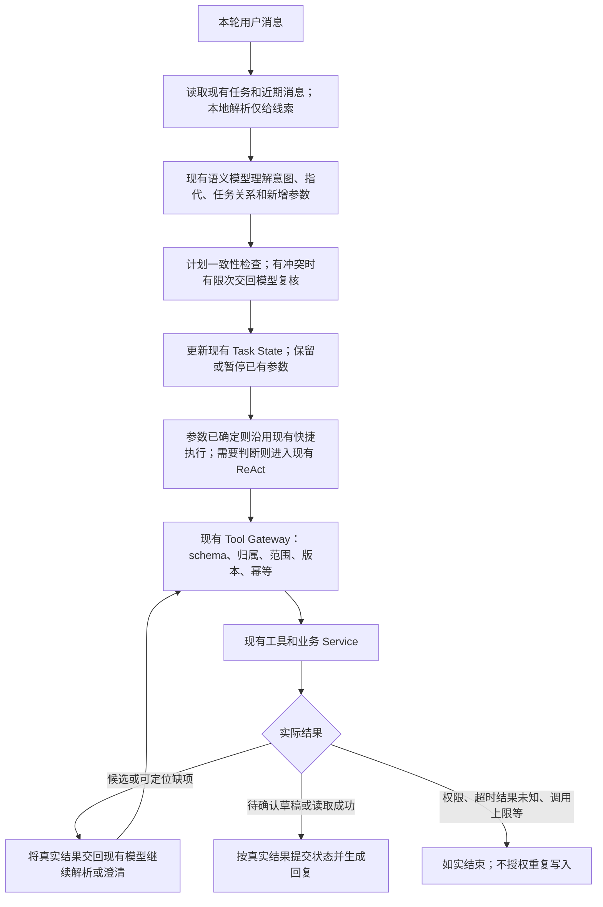

# 多轮 Agent 语义理解与执行衔接验收

日期：2026-10-17。沿用现有入口、执行图、Tool Registry、业务 Service、确认卡、任务状态和执行日志。
本轮没有更换模型、迁移数据库、修改公共 API 或调整前端交互。

## 原因与修改

原来的“卧推55kg4组每组8次”已经被模型理解为实际训练记录，重量和组次也已提取。
问题发生在执行衔接：动作库返回多个变式后，确定性分支立即结束，模型没有机会利用候选继续判断。
本轮检查还发现简短回复可绕过语义模型、部分 missing_fields 被当成不可恢复错误、
别名规范化会与旧目标冲突、插问后的继续可能重建空任务等同类问题。

本轮实际链路为：

这里的回到模型受现有递归上限、工具调用上限、无进展检测和幂等日志约束，不是无限重试。
原来的 User → Planner → Branch → Tool → Safety → Response 主流程保持不变。

## 全部任务类型检查

当前 schema 注册了 **23种任务类型**，不是23个工具；每种任务下可以使用多个现有工具。
新增参数化测试逐项验证它们都经过语义路由，不能由本地规则直接选定意图。

| 任务类型 | 本轮检查与处理 | 保留的实际边界 |
| --- | --- | --- |
| general_question | 可选目标/资料不足不再阻断通用回答；文字营养咨询可估算 | 不伪装读取过记录或网页 |
| knowledge_retrieval | 可选资料不阻断；有实际业务实体时进入认证读取路径 | RAG不足后的联网策略、来源过滤继续保留 |
| structured_data_query | 每轮由模型解释日期、指标和任务关系；插问自动暂存旧任务 | 查询必须有实际读取证据；不确认待处理修改 |
| workout_record_draft | 简称候选回到模型；可以说明假设后生成可修改草稿 | 真实重量、组数、次数不编造；未知动作ID不接受 |
| workout_record_update_draft | 缺ID/版本可通过读取继续定位；真实ID优先于字面别名 | 只能修改对应真实动作；版本检查保留 |
| workout_record_void_draft | 同上；取消已保存数据继续使用作废工具 | 不能只删 Task State冒充撤销业务数据 |
| workout_set_update_draft | 语义规划与现有读取/确认工具复用；软缺项交模型定位 | 训练组归属和版本校验保留 |
| workout_set_void_draft | 同上，保留真实歧义澄清 | 不将作废改成新增或长期记忆 |
| nutrition_record_draft | 已明确食物可估算份量；文本/照片继续复用原链路 | 修改原餐不另建一餐；确认前不记账 |
| nutrition_entry_update_draft | 同餐候选切换不再被旧item_index错误拦截；保留模型重估链路 | 日期/餐次/项目范围、原记录版本和营养依据校验保留 |
| nutrition_entry_delete_draft | 缺定位信息可读取解析；普通“那个”真实歧义仍需澄清 | 整餐删除与单项移除分开，保留未提及食物 |
| nutrition_target_draft | 复用真实资料和原草稿机制；可选字段不作一刀切阻断 | 安全条件和无效数值仍校验 |
| food_catalog_draft | 模型决定新增/修改/删除；缺食品ID/版本可继续读取 | 不能操作公共食品或把食品条目写成记忆 |
| profile_update_draft | 先读真实资料和版本；软缺项可继续由模型和工具处理 | 仅明确要求的资料字段进入确认卡 |
| body_measurement_draft | 复用现有模型、测量提案及确认流程 | 不把估计体重当实际测量写入 |
| training_plan_draft | 复用个人资料与原计划工作流；支持稍后补详情 | 没有合法计划草稿/确认卡不能声称完成 |
| schedule_change_draft | 复用日历读取、调整工具和候选反馈 | 冲突日程不能静默覆盖，保持确认 |
| training_progression_draft | 复用真实训练记录与进阶工具 | 不用普通建议或长期记忆替代进阶提案 |
| confirmation_cancel | 模型先判断取消意图，按真实卡状态执行 | 取消草稿不等于撤销已保存记录；不会自动批准 |
| memory_write | 保留模型语义复核、当前消息证据和长期价值规则 | 不把本轮业务指令、假设或他人事实写成用户记忆 |
| body_assessment | 可用照片已返回观察结果后，解除已解决图片缺项和可选资料缺项 | 无图片、不可用照片、安全条件仍限制 |
| body_progress_comparison | 历史照片补齐后解除旧图片缺项；复用比较工作流 | 实际图片数量和可比质量仍校验 |
| nutrition_analysis | 实际识别/计算结果解决已知食物与估算缺项 | 无照片、无法辨认、计算不完整不能伪装完成 |

## 修改模块

- `agents/intent_router.py`：每条消息都调用现有结构化语义模型；本地线索不具有意图决定权。
  查询中只暂缓旧任务的冗余分支，由计划一致性检查交回同一模型修正。
- `services/agent_planning.py`：取消数字、选择、取消和恢复的本地路由捷径；
  仅在模型认定同一业务任务后使用解析线索，保留真实ID来源及目标冲突校验。
- `services/conversation.py`、`agent_context_builder.py`：增加有界、仅本轮使用的input_hints。
  保留原历史、摘要、窗口和结构化状态，未新增数据库列。
- `services/agent_handlers/general.py`：将确定性执行的可定位结果交回现有ReAct；
  总是提供本轮Action Plan；正常待选择不能因读取工具成功而误判成写入失败。
- `services/agent_resolution.py`：轻量辅助函数，区分真实事实缺失、可读取定位问题、不可直接重试的故障，
  并依据已完成的观察解除非必要缺项，没有另建Agent框架。
- `services/agent_handlers/task_action.py`：保留已确定参数的执行路径；软缺项退回模型工具路径。
- `services/agent_task_state.py`：真实候选选择可切换局部目标；查询中断后的明确继续复用暂停任务；
  训练确认卡的真实ID和规范名称回写原任务，同一实体别名更正不另开空任务。
  支持从needs_review和needs_input两种已有结果恢复丢失的候选。
- 对序号的本地解析只提供线索；最终选择按模型结合实际展示消息理解出的名称或真实ID核验，
  不按原始搜索顺序覆盖模型的选择。对能够可靠解析的已展示编号列表，程序提供实际行与真实ID的
  对应证据；模型若返回冲突ID，先交回模型复核，持续冲突则不执行。
  重复编号、重复对象、断号、无法匹配真实候选的列表不作为确定的选项证据。
- `services/agent_tool_review.py`：真实候选ID和后续版本匹配提案可解除旧别名歧义；
  无真实ID、不同ID、不同版本及只有确认卡的情况仍不算解决。
- `services/agent_handlers/knowledge.py`：可选资料不足不阻断知识回答；
  已保存实体的问题先进入认证数据读取，不能以公开知识估算冒充实际记录。
- `services/agent_handlers/body.py`、`body_progress.py`、`nutrition.py`、`nutrition_record.py`：
  已有可用视觉结果后解除已解决的缺项，保留图片质量、无效输入及真实业务必填项。
- `agents/prompts.py`：动作名语义消歧和可修改草稿假设说明。

保留原有API、数据模型、业务Service、Tool Registry注册体系、worker、确认机制、请求幂等和前端。
快捷执行仍可处理模型已经明确的参数；“每轮让模型理解”并不要求用LLM执行数值计算或版本判断。

## 验证与验收

自动化后端及真实本地PostgreSQL回归：**2030 passed，57 skipped，22.15秒**。
跳过项是配置/平台/真实外部依赖等显式门控用例，不能算作通过。
日志：`.local/semantic-first-backend-tests.log`。

真实模型/API复测使用一次性账号，覆盖：

1. 原句“卧推55kg4组每组8次”，同一轮用真实候选生成杠铃卧推待确认草稿，并说明动作假设。
2. “记录杠铃卧推”→“55kg”→“四组”→插问当天热量→恢复→“8个”→取消草稿。
3. 指定午饭鸡胸肉份量修改后插入实际热量查询；查询不批准草稿、不新建餐食，也不改动正式份量。
4. 用户明确要求先列候选再选动作；再分别用器械简称、序号、自然描述继续，包括旧状态恢复。

复测期间曾发现并修复查询被拆出冗余等待子任务、读取到候选后被误报缺确认卡、
旧保存结果恢复候选、按内部顺序误选实际展示序号等问题。
保留首次失败日志：`.local/semantic-first-live-initial-tests.log`、
`.local/semantic-first-live-candidate-first-tests.log`。
旧状态和显示顺序的首次失败日志：`.local/semantic-first-live-legacy-first-tests.log`、
`.local/semantic-first-live-displayed-ordinal-first-tests.log`。
最终复测日志和结果：`.local/semantic-first-live-tests.log`、`.local/semantic-first-live.json`、
`.local/exercise-clarification-live.json`。最终为 **7 passed，85.61秒**。
本轮修改文件的Ruff检查通过。测试后只读核对100条历次测试执行记录、33个测试会话残留均为0，
本地API健康检查HTTP200；证据为`.local/semantic-first-cleanup-proof.json`。
测试没有使用原账号发送消息、批准确认卡或修改正式数据。

App可按以下步骤手动验收，不必重报已有参数：

- 新会话输入“卧推55kg4组每组8次”：应生成明确动作的待确认草稿，必要假设融入自然回复；
  真实歧义时列出候选，不显示记录失败。
- 输入“先列出卧推动作让我选，先别生成草稿”，再用“第一个”或自然描述选择；
  不应在选择前擅自生成草稿，选择后应保留已收集的重量和组次。
- 分轮提供卧推参数，中间查一次今天饮食，再说“继续刚才的训练”；
  已有重量、组数不应丢失。
- 修改某餐的某项食物后说“先不要改，查一下这顿饭现在多少热量”；
  应查询真实记录并区分未确认预览，不能自动确认或新增一餐。
- 说“算了”时，未执行的收集任务应取消；已有待确认卡时取消卡；
  已保存的数据仍需通过对应作废/删除草稿撤销。

本轮照片改动通过自动化工作流测试，未重新上传真实照片；没有宣称视觉识别精度提高。
本轮没有重新点测模拟器页面或真实iOS，没有部署云端。
模型仍可能误判或超时；有限次纠错之后应如实结束。遇到歧义、没有对应业务工具或真实执行条件不足时，
仍需澄清或说明边界，不能以“交给大模型”为由猜测真实训练事实或绕过确认。
